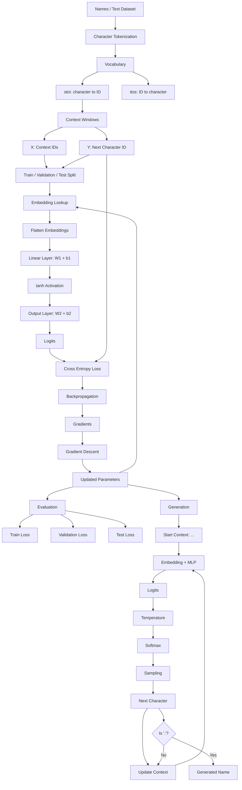

# Makemore — Start to End Flow



## Compact view

```text
                         TRAINING
                            │
                            ▼
                    ┌───────────────┐
                    │     TEXT      │
                    └───────┬───────┘
                            │
                            ▼
                    ┌───────────────┐
                    │  TOKENIZATION │
                    │ chars → IDs   │
                    └───────┬───────┘
                            │
                            ▼
                    ┌───────────────┐
                    │ CONTEXT WINDOW│
                    │ 3 chars → 1   │
                    └───────┬───────┘
                            │
                            ▼
                    ┌───────────────┐
                    │   EMBEDDING   │
                    │ ID → vector   │
                    └───────┬───────┘
                            │
                            ▼
                    ┌───────────────┐
                    │     MLP       │
                    │ Linear+tanh   │
                    └───────┬───────┘
                            │
                            ▼
                    ┌───────────────┐
                    │    LOGITS     │
                    └───────┬───────┘
                            │
                            ▼
                    ┌───────────────┐
                    │ CROSS ENTROPY │
                    │     LOSS      │
                    └───────┬───────┘
                            │
                            ▼
                    ┌───────────────┐
                    │ BACKPROPAGATE │
                    └───────┬───────┘
                            │
                            ▼
                    ┌───────────────┐
                    │ UPDATE PARAMS │
                    └───────┬───────┘
                            │
                            └─────────────┐
                                          │
                                          ▼
                                       REPEAT


                        GENERATION
                            │
                            ▼
                       "... ..."
                            │
                            ▼
                         MODEL
                            │
                            ▼
                         LOGITS
                            │
                            ▼
                       TEMPERATURE
                            │
                            ▼
                         SOFTMAX
                            │
                            ▼
                        SAMPLING
                            │
                            ▼
                    NEXT CHARACTER
                            │
                            ▼
                    UPDATE CONTEXT
                            │
                            └─────────────┐
                                          │
                                          ▼
                                        REPEAT
                                          │
                                  "." = STOP
                                          │
                                          ▼
                                   GENERATED NAME
```
